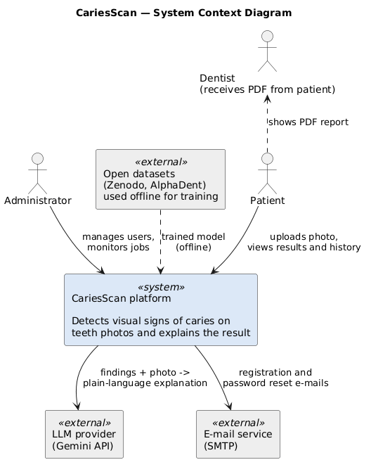
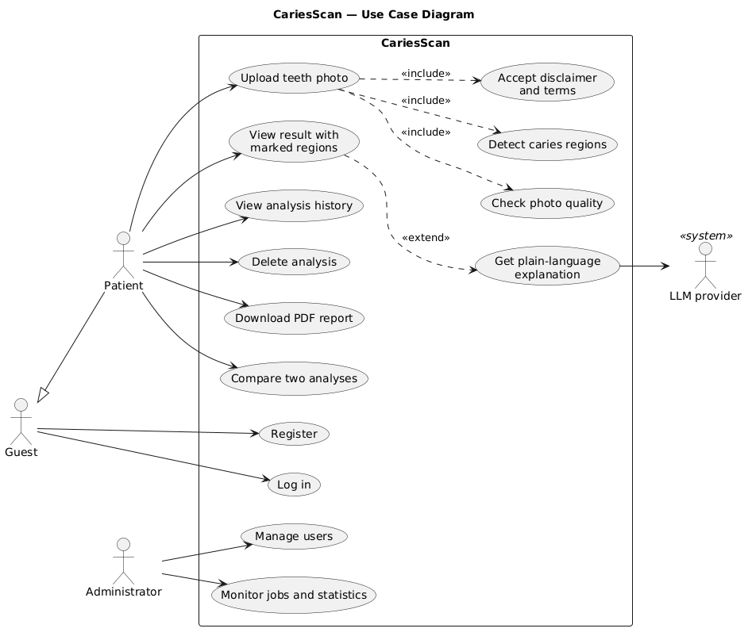
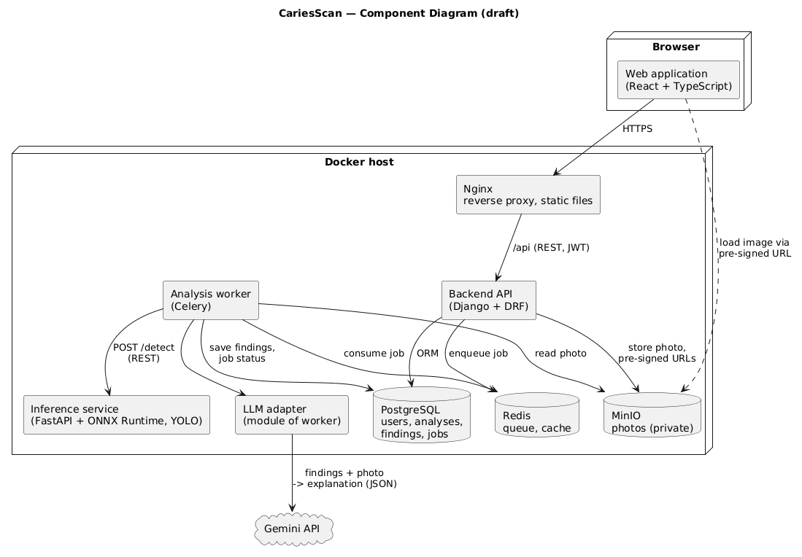

# 7. Architecture and Diagrams

Editable sources (PlantUML): [diagrams/src](../diagrams/src). Rendered: [diagrams/export](../diagrams/export).
To re-render: paste a `.puml` file into https://www.plantuml.com/plantuml or run
`plantuml diagrams/src/*.puml`.

## 7.1 System context

The platform has two human actors (patient, administrator) and two external systems: the LLM
provider used for explanations and an e-mail service. Open datasets are used only offline to
train the model; no patient photos leave the platform except the photo sent to the LLM for
explanation, which the user accepts in the terms (FR-2).

## 7.2 Use cases

"Upload teeth photo" always includes consent, the quality check and detection, so detection
never runs on an unusable photo (FR-4). The explanation extends the result view: if the LLM is
unavailable, the result is still shown (NFR-5).

## 7.3 Components (draft)

| Component | Responsibility | Requirements |
|---|---|---|
| Web application (React) | UI: upload, result with boxes, history, consent | FR-3, FR-6, FR-9, FR-13, NFR-11 |
| Nginx | TLS termination, static files, routing `/api` | NFR-8 |
| Backend API (Django + DRF) | Accounts, consent, analyses, history, admin, pre-signed URLs | FR-1, FR-2, FR-9, FR-10, FR-12, NFR-9 |
| Analysis worker (Celery) | Runs the analysis pipeline asynchronously, retries | NFR-2, NFR-4, NFR-6 |
| Inference service (FastAPI + ONNX Runtime) | Quality check and caries detection, stateless | FR-4, FR-5, NFR-1, NFR-7 |
| LLM adapter | Builds the prompt from findings, calls Gemini, validates JSON | FR-7, FR-8, NFR-5 |
| PostgreSQL | Users, consents, analyses, findings, job status | FR-9 |
| Redis | Job queue, cache | NFR-3 |
| MinIO | Private photo storage | NFR-9 |

## 7.4 Main scenario: analysis of a photo

1. The web app sends `POST /api/analyses` with the photo (JWT required).
2. The API validates format/size (FR-3), stores the photo in MinIO, creates an `Analysis`
   with status `queued`, enqueues a job, returns `202` with the analysis id.
3. The worker reads the photo and calls `POST /detect` of the inference service.
4. The inference service runs the quality check; if the photo is unusable it returns a reason,
   the analysis becomes `rejected` with advice (FR-4).
5. Otherwise it returns findings `[ {box, class, confidence} ]` (FR-5); the worker stores them.
6. The worker calls the LLM adapter with the findings as facts; the adapter validates that the
   explanation does not add findings (FR-8). On timeout/error the analysis is completed without
   explanation (NFR-5).
7. The web app polls `GET /api/analyses/{id}` until `done`, then loads the photo by a
   pre-signed URL and draws boxes (FR-6).

## 7.5 Draft data model

| Entity | Main fields |
|---|---|
| User | id, email, password_hash, role (patient/admin), language, created_at |
| Consent | user_id, version, accepted_at |
| Analysis | id, user_id, image_key, status (queued/processing/done/rejected/failed), quality_reason, model_version, explanation, created_at, finished_at, timings_ms |
| Finding | id, analysis_id, x, y, width, height, class, confidence |

`model_version` and `timings_ms` are stored for every analysis so that quality and
performance experiments (doc 09) can be reproduced from real data.

## 7.6 Draft API

| Method | Path | Description |
|---|---|---|
| POST | /api/auth/register, /api/auth/login, /api/auth/refresh | Accounts (JWT) |
| POST | /api/consent | Accept terms and disclaimer |
| POST | /api/analyses | Upload photo, create analysis (202) |
| GET | /api/analyses | History (paginated) |
| GET | /api/analyses/{id} | Status, findings, explanation, signed image URL |
| DELETE | /api/analyses/{id} | Delete analysis and photo |
| POST | /detect (internal, inference service) | Quality check + detection |
